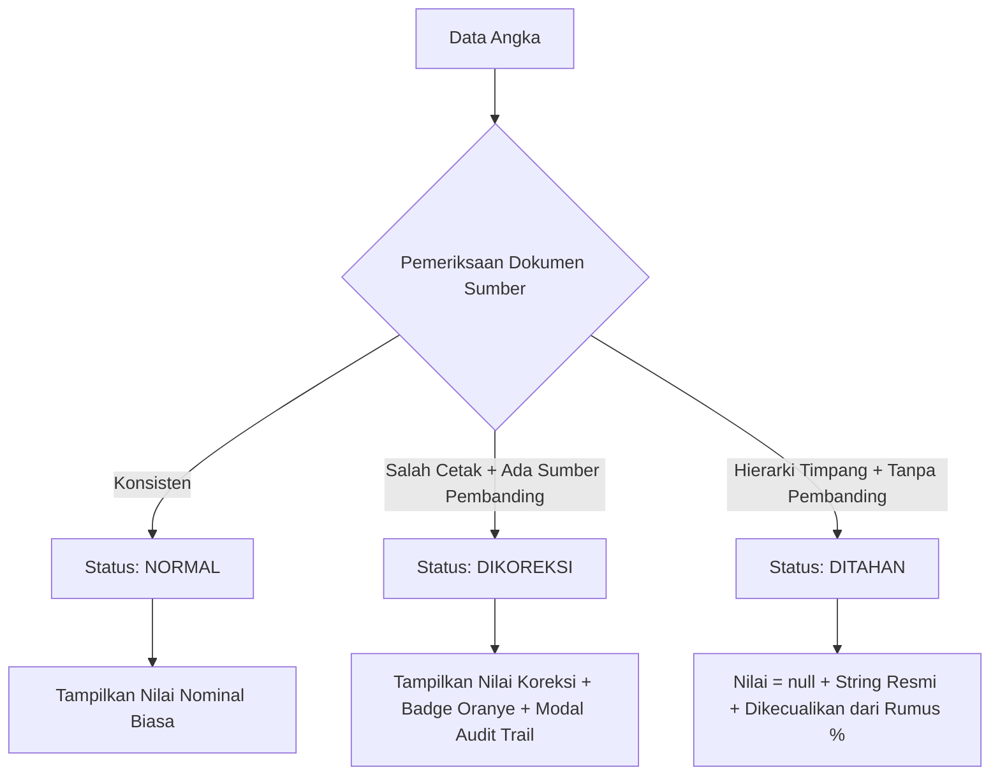

# Product Requirements Document (PRD) — JejakPublik

**Versi:** 1.0 (Final MVP Spec)  
**Tenggat First Draft:** 1 November 2026 (WIA - MIA 2026)  
**Tim Pengembang:** miamiu (Zayyan, Mahdi, Liaurentino)  
**Status Acuan:** Single Source of Truth Teknis (Wajib dipatuhi seluruh AI Agent)

---

## 1. Ringkasan Eksekutif & Arsitektur Data 2 Lapis

JejakPublik adalah aplikasi web transparansi dan audit integritas anggaran daerah Provinsi DKI Jakarta (Tahun Anggaran 2025 - periode selesai). Web ini tidak sekadar memvisualisasikan angka, melainkan menguji keabsahan dokumen resmi, menandai anomali salah ketik, dan meluruskan istilah akuntansi publik yang kerap disalahartikan awam.

### Arsitektur Data Dua Lapis (Two-Tier Model)

[Provinsi DKI Jakarta 2025] │ ├── Lapis Luas: 43 SKPD (Dashboard BPKD) │ ├── 3 Pilar Mandiri: Pendapatan | Belanja | Pembiayaan │ └── Batas Kedalaman: Ringkasan tingkat dinas (42 SKPD) │ └── Lapis Dalam (Pilot): Dinas Lingkungan Hidup (LKIP 2025) ├── 8 Program ├── 15 Kegiatan ├── 33 Subkegiatan (dengan State Engine: Normal, Dikoreksi, Ditahan) ├── 12 Indikator Kinerja & Pelurus Semantik "Efisiensi" (Tabel 3.35) └── 10 Unit Kerja Pelaksana (Tabel 3.33)
| Parameter | Lapis Luas (Seluruh SKPD) | Lapis Dalam (Pilot DLH) |
| :--- | :--- | :--- |
| **Cakupan Entitas** | 43 SKPD DKI Jakarta | Dinas Lingkungan Hidup DKI Jakarta |
| **Sumber Primer** | Dashboard Keuangan BPKD DKI (`bpkd-skpd-2025.json`) | LKIP DLH TA 2025 (55 halaman PDF & Tabel 2.4, 3.33, 3.34, 3.35) |
| **Kedalaman Rincian**| Agregat SKPD | Program &rarr; Kegiatan &rarr; Subkegiatan |
| **Tiga Pilar APBD** | Pendapatan, Belanja, Pembiayaan terpisah | Alokasi Penetapan, Perubahan, Realisasi, Capaian Kinerja |
| **Penanganan Nol** | Tanpa pembiayaan = `"Tidak dilaporkan"`, BUKAN `Rp0` | Nilai hierarki anomali = `"Ditahan"`, BUKAN `Rp0` |

---

## 2. Peta Halaman (Routes) & Sitemap Fungsional

| Route URL                    | Komponen Halaman     | Dataset Lokal (`src/data/`)                                                                                                           | Tujuan & Konten Utama                                                                                                                                                         |
| :--------------------------- | :------------------- | :------------------------------------------------------------------------------------------------------------------------------------ | :---------------------------------------------------------------------------------------------------------------------------------------------------------------------------- |
| `/`                          | `Home.tsx`           | `bpkd-skpd-2025.json`                                                                                                                 | Ringkasan 3 pilar APBD DKI 2025, tabel 43 SKPD dengan filter pencarian & komisi, penanda kedalaman data, serta 4 kartu nilai pembeda.                                         |
| `/instansi/lingkungan-hidup` | `InstansiDetail.tsx` | `dlh-realisasi-anggaran-2025.json`, `dlh-alokasi-anggaran-2025.json`, `dlh-efisiensi-indikator-2025.json`, `dlh-unit-kerja-2025.json` | Penelusuran hierarki 8 Program &rarr; 15 Kegiatan &rarr; 33 Subkegiatan, Data State Engine (B3 & Gaji ASN), tab 12 indikator kinerja, tab 10 unit kerja, dan metadata sumber. |
| `/istilah`                   | `Glossary.tsx`       | Metadata statis                                                                                                                       | Glosarium interaktif 8 istilah resmi APBD & akuntansi kinerja dengan peringatan semantik istilah "Efisiensi".                                                                 |
| `/tentang`                   | `About.tsx`          | Metadata statis                                                                                                                       | Transparansi metodologi sumber LKIP/BPKD, 6 Anti-Goals resmi, dan profil tim miamiu.                                                                                          |
| `/laporkan`                  | `ReportDemo.tsx`     | Supabase / Mock Handler                                                                                                               | _(Backlog P2)_ Formulir demonstrasi pelaporan koreksi data & observasi lapangan berlabel _Laporan Warga_.                                                                     |
| `*`                          | -                    | -                                                                                                                                     | Fallback otomatis (redirect) ke `/`.                                                                                                                                          |

---

## 3. Spesifikasi Fungsional Inti (Prioritas P0 - Wajib First Draft)

### Modul 1: Eksplorasi Anggaran Multi-Level (F-01, F-02, F-03, F-04, F-11)

- **F-01 Ringkasan Provinsi di Beranda:**
  - _IF_ pengguna membuka `/` _THEN_ sistem menampilkan 3 kartu pilar mandiri: Belanja (Pagu vs Realisasi vs % Serapan), Pendapatan (Target vs Realisasi vs % Capaian), dan Pembiayaan Netto.
  - _ATURAN:_ Dilarang menjumlahkan ketiga pilar menjadi satu angka saldo netto.
  - _Acceptance Criteria:_ Total angka 100% cocok dengan penjumlahan 43 baris di `bpkd-skpd-2025.json`. Label TA 2025 dan sumber BPKD terlihat jelas tanpa interaksi klik.
- **F-02 Katalog 43 SKPD:**
  - _IF_ SKPD adalah Dinas Lingkungan Hidup _THEN_ render badge hijau `[Dapat ditelusuri sampai sub kegiatan]` dan tombol aktif menuju `/instansi/lingkungan-hidup`.
  - _IF_ SKPD selain DLH _THEN_ render badge netral `[Hanya tingkat SKPD]`.
  - _IF_ kolom `PEMBIAYAAN_ANGGARAN` bernilai `null` _THEN_ render teks `"Tidak dilaporkan"` (bukan `Rp0`).
  - _Acceptance Criteria:_ Pencarian teks instan memfilter nama dinas secara akurat (_case-insensitive_).
- **F-03 & F-04 Penelusuran Hierarki DLH:**
  - _IF_ pengguna membuka `/instansi/lingkungan-hidup` _THEN_ tampilkan 4 kartu ikhtisar: APBD Penetapan (Rp3,80 T), APBD Perubahan (Rp3,71 T - turun Rp81,08 M dampak Inpres 1/2025), Realisasi (Rp3,36 T), dan Persentase Terserap (90,40%).
  - Tampilkan akordeon interaktif: Program (8) &rarr; Kegiatan (15) &rarr; Subkegiatan (33).
  - _Acceptance Criteria:_ Tombol "Buka Semua Rincian" dan "Tutup Semua" berfungsi mulus.
- **F-11 Transparansi Sumber Primer per Angka:**
  - _Acceptance Criteria:_ Setiap halaman mencantumkan nomor dokumen, nomor tabel (Tabel 2.4, 3.33, 3.34, 3.35), dan tanggal penarikan data (21 Oktober 2026).

---

### Modul 2: Data State Engine & Modal Rekonsiliasi (F-08, F-09)

Setiap angka anggaran wajib memiliki satu dari tiga status:

